  &nbsp;
  &nbsp;
  &nbsp;
  

Estudiante de **Ingeniería de Software** en la Universidad Cooperativa de Colombia, Medellín. Desarrollo back-end con **Java y Spring Boot**, trabajo con datos en **Python y PostgreSQL**, construyo sitios con **HTML, CSS y JavaScript** y participé en la planeación de una app móvil en **Flutter**. Busco oportunidades de **práctica profesional** en desarrollo de software, presencial, híbrida o remota.


  <a href="https://github.com/geminitodo5-sketch/app-educativa-medellin"></a>
  <a href="https://github.com/AlexanderM-Code/Entre-sorbos---Casa-Rendon"></a>

  <a href="https://github.com/AlexanderM-Code/CineX---Proyecto-Final"></a>
  <a href="https://github.com/qxsantx/Trabajo-Final-Arquitectura-de-Software"></a>

  <a href="https://github.com/qxsantx/Computacion-Ubicua"></a>
  <a href="https://github.com/qxsantx/Evaluacion-programacion"></a>



<a href="mailto:santiagomayorga777@gmail.com"></a>
