<picture>
  <source media="(prefers-color-scheme: dark)" srcset="assets/header-dark.svg">
  
</picture>

 

<picture>
  <source media="(prefers-color-scheme: dark)" srcset="assets/sec-projects-dark.svg">
  
</picture>

<a href="https://github.com/geminitodo5-sketch/app-educativa-medellin">
  <picture>
    <source media="(prefers-color-scheme: dark)" srcset="assets/card-numi-dark.svg">
    
  </picture>
</a>

<a href="https://github.com/AlexanderM-Code/Entre-sorbos---Casa-Rendon">
  <picture>
    <source media="(prefers-color-scheme: dark)" srcset="assets/card-sorbos-dark.svg">
    
  </picture>
</a>

<a href="https://github.com/AlexanderM-Code/CineX---Proyecto-Final">
  <picture>
    <source media="(prefers-color-scheme: dark)" srcset="assets/card-cinex-dark.svg">
    
  </picture>
</a>

 

<picture>
  <source media="(prefers-color-scheme: dark)" srcset="assets/sec-stack-dark.svg">
  
</picture>

<picture>
  <source media="(prefers-color-scheme: dark)" srcset="assets/stack-dark.svg">
  
</picture>

 

<picture>
  <source media="(prefers-color-scheme: dark)" srcset="assets/sec-work-dark.svg">
  
</picture>

<picture>
  <source media="(prefers-color-scheme: dark)" srcset="assets/work-dark.svg">
  
</picture>

 

<a href="mailto:santiagomayorga777@gmail.com">
  <picture>
    <source media="(prefers-color-scheme: dark)" srcset="assets/footer-dark.svg">
    
  </picture>
</a>
